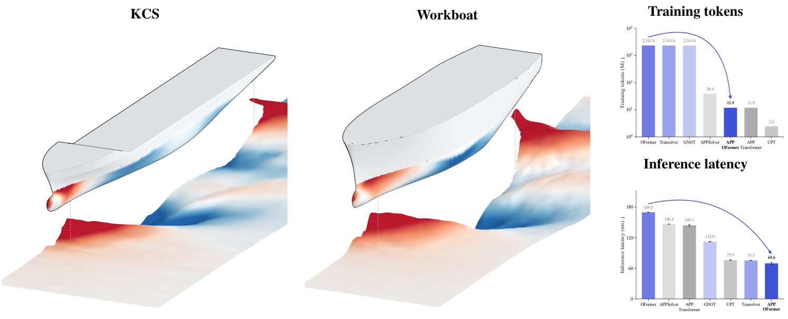

# APPv2

**Adaptive Patch Tokenization for Joint Operator Learning of Ship Flow and Hull Pressure**

[](https://huggingface.co/datasets/wenhuahuo/ShipBenchv2)

APPv2 is a research codebase for learning calm-water ship free-surface fields and wetted-hull pressure from geometry and operating conditions. Its primary model, **APP-OFormer**, combines APP adaptive patch tokenization with an OFormer backbone. APP converts dense free-surface and hull samples into compact geometry-aware tokens, while continuous coordinate decoders predict the five free-surface channels `eta`, `u`, `v`, `w`, and `p_rgh` together with wetted-surface `Cp`.

APPv2 is the paper and project name. APP-OFormer is the main model and appears as `appsolver_oformer` in source and configuration paths. The repository also provides APPSolver-v2 under `configs/appsolver_v2/` as a separate APP-based model.



## Method highlights

- **Adaptive patch tokenization.** Geometry-controlled partitioning places fine patches near the hull and coarser patches in the far field. Quadrature-weighted integration aggregates each patch into a token.
- **Joint dual-domain learning.** Free-surface coordinates and wetted-hull UV coordinates, positions, and normals share an OFormer backbone with domain-specific output heads.
- **Operating-condition encoding.** Layer-wise Fourier features inject `Fr` and `log10 Re` throughout the encoder and decoder.
- **Continuous coordinate queries.** Independent query decoding supports free-surface and hull prediction at selected coordinates and query densities.

## Performance at a matched compute budget

Both models use the same dual-domain task and training protocol at roughly 250 billion floating-point operations per forward pass. The table reports the mean and sample standard deviation across three training seeds on the random split. Each model is evaluated at full query density with its best checkpoint.

| Model | Backbone tokens | Flow NRMSE, % ↓ | Hull Cp RMSE ↓ | Forward GFLOPs |
| --- | ---: | ---: | ---: | ---: |
| **APP-OFormer** | **625** | **59.79 ± 0.60** | **0.0372 ± 0.0008** | 251.41 |
| OFormer | 123,241 | 59.86 ± 2.29 | 0.0488 ± 0.0015 | 253.05 |

APP-OFormer reduces the backbone sequence by 197× relative to point-wise OFormer while retaining comparable flow accuracy and improving hull-pressure RMSE. GFLOPs follow the published single-sample KCS profiling protocol with float32 at `stride=1`.

## ShipBenchv2

ShipBenchv2 contains **224 quasi-steady OpenFOAM samples across 169 hull geometries**. The collection combines 66 samples for 11 classic hulls with 158 samples for morphed hull geometries. Each sample provides free-surface geometry and five-channel targets, wetted-hull geometry and `Cp`, quadrature weights, and operating conditions.

The official split definitions are stored in [`configs/splits_multihull.json`](configs/splits_multihull.json). Each split has its own normalization statistics fitted on its training entries. The held-out entries select `best.pt` and provide the reported evaluation metrics.

| Split | Train | Held out | Protocol | Normalization statistics |
| --- | ---: | ---: | --- | --- |
| `random_seed0` | 190 | 34 | Random 15% holdout with seed 0 | `stats_random_seed0.json` |
| `loto_kvlcc2` | 218 | 6 | Six operating conditions of the classic KVLCC2 hull held out | `stats_loto_kvlcc2.json` |
| `lofo_fr_design` | 213 | 11 | Design-Fr case held out for each classic hull | `stats_lofo_fr_design.json` |

## Reproduce

Run all commands from the repository root with **Python 3.11 or newer**.

### 1. Install dependencies

```bash
python -m venv .venv
source .venv/bin/activate
python -m pip install --upgrade pip
python -m pip install .
```

The entry points are the source scripts under `scripts/`. Run them directly from the repository root as shown below.

### 2. Prepare ShipBenchv2

Download the four archives and `SHA256SUMS` from [ShipBenchv2 on Hugging Face](https://huggingface.co/datasets/wenhuahuo/ShipBenchv2). Verify the checksums and extract the archives into `dataset/` as described in the dataset card. The archives include the index and split-specific normalization files. The training configurations expect this layout:

```text
dataset/shipbench/
├── index.json
├── stats_random_seed0.json
├── stats_loto_kvlcc2.json
├── stats_lofo_fr_design.json
└── <entry_id>/
    ├── meta.json
    └── sample arrays
```

The YAML configurations already contain the official entry lists and reference the corresponding data root and statistics. They can be used directly with the released dataset.

### 3. Rebuild statistics optionally

The released statistics are the direct path for reproducing the reported runs. To rebuild all three files from the training entries instead, run:

```bash
for split in random_seed0 loto_kvlcc2 lofo_fr_design; do
  python scripts/datapipe/build_stats.py \
    --dataset dataset/shipbench \
    --output "dataset/shipbench/stats_${split}.json" \
    --entries $(python -c "import json; print(' '.join(json.load(open('configs/splits_multihull.json'))['${split}']['train']))")
done
```

### 4. Train and evaluate APP-OFormer

The official APP-OFormer configuration trains for 100 epochs with AdamW, learning rate `1e-3`, weight decay `1e-4`, `train_strides: [1]`, and joint flow and hull supervision. It selects `train.device: cuda` for GPU training.

This loop reproduces the three training seeds on `random_seed0` and evaluates each best checkpoint on the held-out split:

```bash
for config in \
  configs/appsolver_oformer/appsolver_oformer_random_seed0{,_train_seed1,_train_seed2}_isoflops.yaml
do
  python scripts/train/train_model.py --config "$config"
  python scripts/eval/evaluate_model.py \
    --config "$config" \
    --checkpoint best.pt \
    --splits val
done
```

Training writes `best.pt` and `last.pt`. Evaluation reads `best.pt` and writes `metrics_best.json`. Every configuration has its own output directory named after the configuration stem. For seed 0, the main artifacts are:

```text
output/appsolver_oformer_random_seed0_isoflops/
├── best.pt
├── last.pt
└── metrics_best.json
```

For the other two splits, use these official configurations and their corresponding `train_seed1` and `train_seed2` files:

```text
configs/appsolver_oformer/appsolver_oformer_loto_kvlcc2_isoflops.yaml
configs/appsolver_oformer/appsolver_oformer_lofo_fr_design_isoflops.yaml
```

To run the OFormer comparison, replace `appsolver_oformer` with `oformer` in both the configuration directory and filename. After evaluating both sets of runs, aggregate the results across seeds:

```bash
python scripts/eval/summarize_generalization.py \
  --task main --models appsolver_oformer oformer \
  --json output/main_experiment_summary.json
```

## Code map

| Path | Contents |
| --- | --- |
| `src/app/` | Adaptive partitioning and patch integration |
| `src/model/` | APP-OFormer, APPSolver-v2, and model components |
| `src/datapipe/` | ShipBenchv2 loading, collation, and normalization |
| `src/train/` | Training, losses, and seeding |
| `scripts/train/` | Configuration generation and training entry point |
| `scripts/eval/` | Evaluation and analysis entry points |
| `configs/` | Official model, split, seed, and ablation configurations |

## License

This project is distributed under the terms in [LICENSE](LICENSE).
